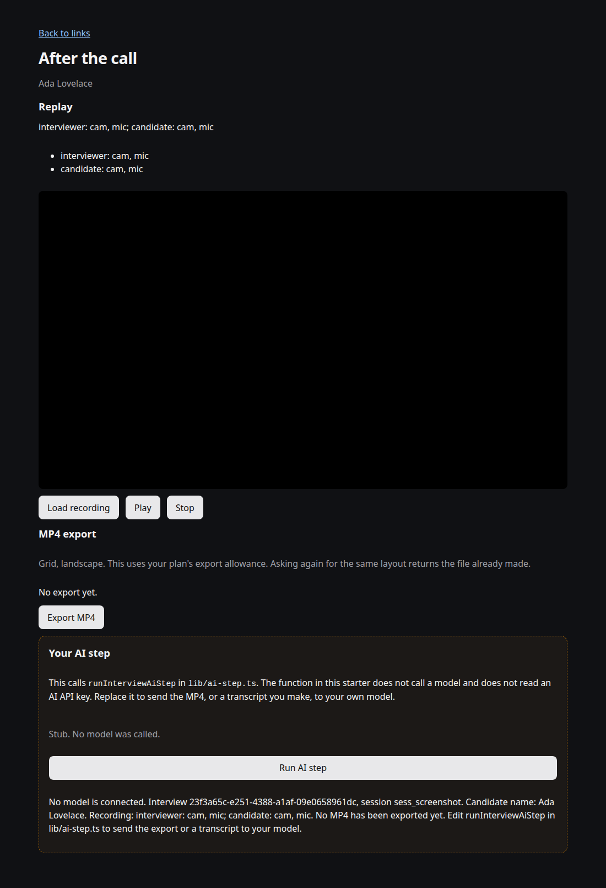

# AI interview recorder

A recorded 1:1 interview on the published Synento SDKs. The interviewer creates
a link, the candidate joins in the browser, and after the call the app plays
the recording and can export an MP4. The AI step is a function you replace. This
starter does not call a model and does not ship an AI API key.

The call uses `@synento/node` on the server and `@synento/react` in the
browser. Replay uses `@synento/player`. The API key never goes to the browser.

## What you need

- Node.js 22 or newer
- A secret `sk_live_` API key from the [Synento dashboard](https://app.synento.com), under API keys. [Sign up](https://synento.com/signup) if you need an account.
- That key is required, and it is server-side only. Replay and MP4 export need it. An `rk_live_` restricted key is refused: the app shows an error on every page instead of starting a call it cannot replay.

| Package | Version |
| --- | --- |
| `@synento/node` | ^0.6.0 |
| `@synento/client` | ^0.5.2 |
| `@synento/react` | ^0.3.0 |
| `@synento/player` | ^0.4.2 |

## Setup

```bash
npm install
cp .env.example .env.local
```

Edit `.env.local` and set `SYNENTO_API_KEY` to your `sk_live_` key. Do not commit that file.

```bash
npm run dev
```

Open <http://localhost:3010>. Create an interview, open the candidate link in a second browser or a private window, and join from both. Press **Join and publish** and allow the camera and microphone. End the call as the interviewer to open the replay.

`SYNENTO_API_URL` is optional. It defaults to `https://api.synento.com`.

## What you should see

1. A page that creates an interview link.
2. Two join pages (interviewer and candidate) with local preview and the other person's video.
3. A review page: **Load recording**, **Play**, **Export MP4**, and **Run AI step**. The AI button says that no model was called.



Interviews are stored in memory. Restarting the dev server forgets them. Anyone with the interview id can join either seat. Add your own auth before putting this on the internet.

## Your AI step

`lib/ai-step.ts` is marked `PLUG IN YOUR MODEL HERE`. Replace `runInterviewAiStep`. The review page already passes the manifest summary and, once you have exported, a same-origin path that streams the MP4. Fetch that path from the server, or send a transcript you produce, to your own model. Do not add a paid AI key to this example's dependencies.

## Tests

```bash
npm test
```

The test does not place a call. It checks the in-memory interview book, how export responses are read, the API-key check, and that the AI stub does not look up a model key.

## Licence

[MIT](LICENSE). Copyright 2026 Synento.
